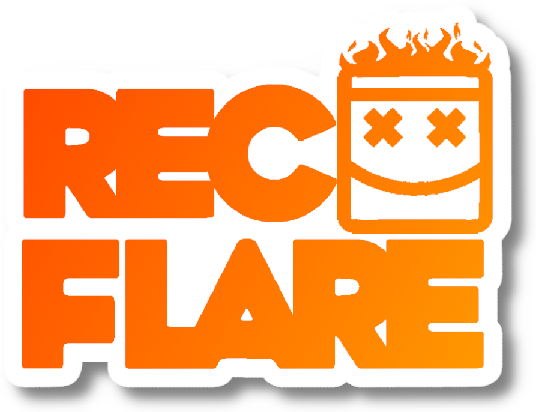

# RecFlare Launcher

one click launcher for RecFlare on rec room **20260323.14**. no injector!!

**download:** grab `RecFlare.Launcher.zip` from [releases](../../releases/latest), unzip, run `RecFlare Launcher.exe`, press play.

the game isn't in the zip. if you don't have it yet the launcher shows **download**, you pick where it goes
and it grabs rec room 20260323.14 from the RecFlare mirror (4.5 GB download, about 6.8 GB unpacked, have 12 GB free).
if it stops, press it again and pick the same place, it picks up where it left off. the zip is checked against a pinned
sha256 before anything gets unpacked.

the **steam id** switch flips `steam_appid.txt` between spacewar (480, the default) and rec room (471710). it gets written
when you switch and every time you press play.

## how it works

- **the launcher** (`src/launcher.cpp`) downloads the game if you need it, checks your install is 20260323.14 (sha256 of GameAssembly / Referee / UnityPlayer, only once),
  drops `2026loader.dll` + `2026patch.dll` (+ `2026patch.ini` if you don't have one) into the game folder, and adds an import of
  `2026loader.dll` to `RecRoom.exe` (stock one kept as `RecRoom.original.exe`). then it starts the game and closes when the patch says it's hooked.
- **the loader** (`loader/loader.cpp`) does what Injector.exe used to do, but from inside the game:
  - sets up the local Referee arena from a DLL load notification, because Referee sets the slot and uses it during its own startup
    while holding the loader lock, so a normal thread can't get in there
  - prewarms the game modules in the file cache, because the patch hashes ~384 MB before hooking and on a slow drive the game hits the
    name server first
  - loads `2026patch.dll` once GameAssembly is in, and holds the main thread for a moment until the patch log says `hooks enabled` (20 s cap)
- **the patch** is [recflare/patch-2026](https://github.com/recflare/patch-2026), embedded as-is (`payload/`)

command line: `--play`, `--vr`, `--folder "<game folder>"`

## building

needs visual studio 2022 with the c++ x64 tools. run `build.cmd`, you get `build/RecFlare Launcher.exe`.
`res/make-assets.ps1` remakes the logo + icon from the source art.

## credits

- [recflare/patch-2026](https://github.com/recflare/patch-2026) for the patch (MIT), which builds on
  [Carpetsoft/Rec-Room-2025-Patch](https://github.com/Carpetsoft/Rec-Room-2025-Patch) and [recflare/patch-2025](https://github.com/recflare/patch-2025)
- [MinHook](https://github.com/TsudaKageyu/minhook) (BSD 2-clause, inside the patch)

see `THIRD-PARTY-NOTICES.txt`. not affiliated with rec room inc / against gravity.
